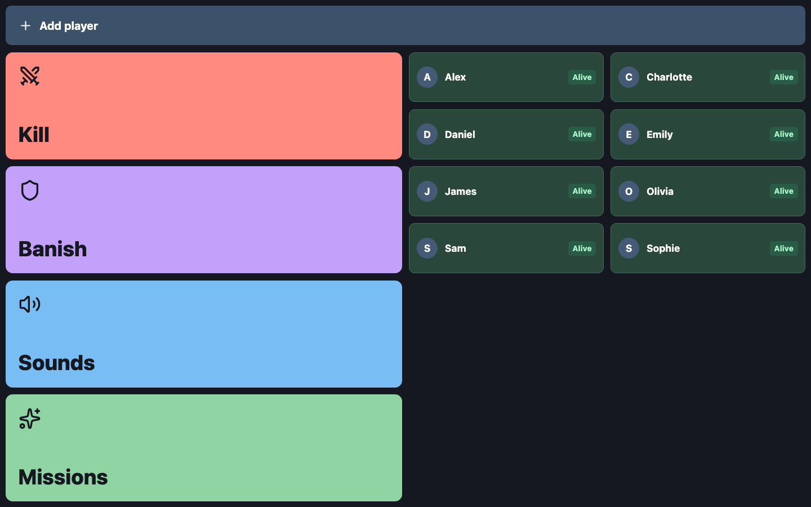

# The Traitors Dashboard



A tablet dashboard for the host of a Traitors-style party game. The host runs the game but does not play. The TV creates a game. The host and players join using its room code. Bring your own accusations.

## Get started

Use Node.js 20.19 or later, or Node.js 22.12 or later. Vite 8 requires these versions.

```bash
npm install
npm run dev
```

Open the URL that Vite prints. Add Supabase configuration before starting a shared game. New games start with no players.

```bash
npm run build    # Build the app into dist/
npm run preview  # Serve the production build locally
npm run lint     # Run Oxlint
```

## Run the tests

The end-to-end tests exercise the dashboard in Chromium and shared games in Chromium and Firefox. The shared-game tests use the configured Supabase project and delete their test rooms. Install the browsers once, then run the suite.

```bash
npx playwright install chromium firefox
npm test
```

GitHub Actions runs lint and tests on pushes and pull requests. Multiplayer tests require the `VITE_SUPABASE_URL` and `VITE_SUPABASE_PUBLISHABLE_KEY` repository secrets. Tests skip shared games if these are unavailable. The Vercel deployment is separate from the GitHub Actions workflow.

## How to host

1. On the TV, choose TV and create a game. The TV displays the room code.
2. On the host device, choose Host and join with the code. Players choose Player and join with the code and their names.
3. The host assigns roles, starts a vote or a night, and uses Banish to record the round-table result.
4. Players cast one locked choice in each vote. If a night vote ties, the host chooses among the tied players.
5. Open Sounds. Tap an effect to play it once. Hold it until the bar fills to loop it.
6. Tap a playing effect to fade it out. Use Stop all to stop every sound immediately.

You can play several effects at the same time. Connect the tablet to a speaker through its Bluetooth settings. The app serves its sound files from the same site.

## Install on a tablet

Open the deployed site over HTTPS. In Firefox or Chrome on Android, open the browser menu and select "Install" or "Add to Home screen". On an iPad, open the site in Safari, tap Share, and select "Add to Home Screen".

Open the installed app once while online to cache the dashboard. The browser caches sound files as it requests them. Test each sound offline on the tablet before the game. A shared game needs a network connection. The app saves the current session on the device and reconnects when the network returns.

## Project files

| Path | Purpose |
| --- | --- |
| `src/App.jsx` | Views, player state, audio playback, and touch controls |
| `src/App.css` | Dashboard layout and styles |
| `src/sounds.json` | Sound effect labels and file paths |
| `public/sounds/` | Bundled audio and source credits |
| `tests/` | End-to-end tests |
| `docs/GLOSSARY.md` | Game and application terms |
| `docs/GOAL.md` | Original game brief and planned flow |

The app uses React, Vite, and Lucide icons. Sound effects come from Mixkit. See `public/sounds/CREDITS.md` for the license link and credits.

## Current limits

Game state is stored in Supabase. A player can reconnect with the room code and name. Anyone who knows both can impersonate that player and see their role. Use this only with people you trust. The host session is saved on its device. If the host clears its browser data, it cannot reclaim that host session.

The app checks for updates every two seconds. Night choices lock after one vote per traitor. A tied night vote goes to the host or TV to resolve. Game sessions have no automatic expiration yet.

Kill and banishment narration uses a placeholder tone. The Missions view is empty. Automatic win checks, role reveal cards, and a night timer are not implemented. See `docs/GOAL.md` for the original brief.

## Version 2 development

Version 2 uses a dedicated Supabase project for shared game state. Copy `.env.example` to `.env.local` and set the project URL and publishable key. Never put a service-role key in a `VITE_` variable. Apply the SQL migrations in `supabase/migrations/` to the dedicated project. The browser uses only the publishable key. Do not use an existing project with unrelated tables.
