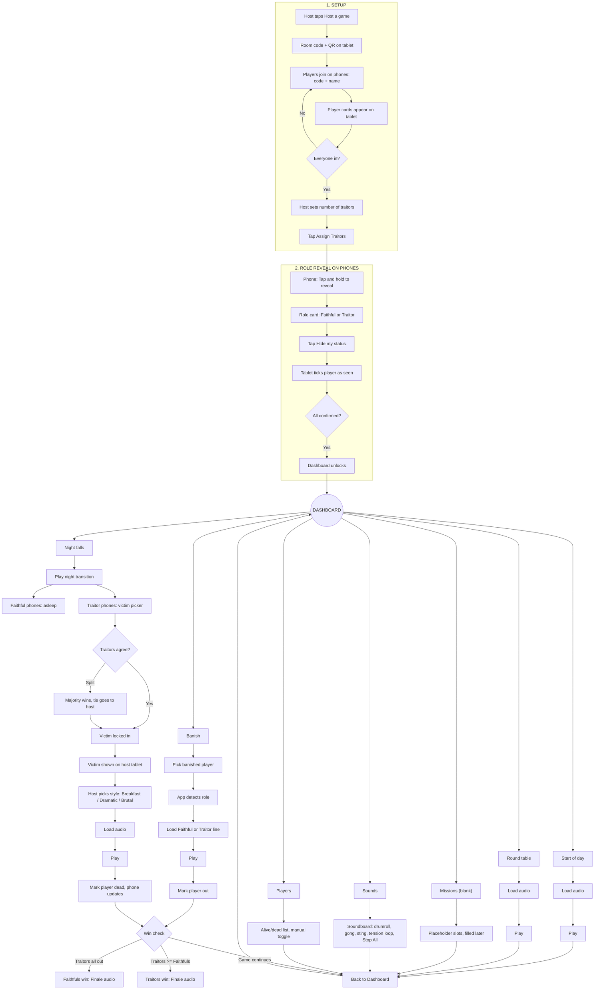

# Traitors Dashboard: Full Brief

## 1. Overview

A Traitors-style party game for a weekend away. The host is a non-player who runs a tablet dashboard of big rounded buttons, connected to a Bluetooth speaker in the middle of the room. The buttons play personalised, pre-generated narration with each player's name in it. Players join on their own phones, get their secret role privately, and (if they're traitors) pick the night's victim on their phones. Voting and banishment discussion happen out loud in the room.

## 2. Decisions locked in

- The host is a non-player and runs the game only.
- Traitors choose the night victim on their phones.
- Voting is out loud. The host just taps who got banished.
- Missions are blank for now. The dashboard has an empty Missions card with placeholder slots, filled in later.

## 3. Roles and what each screen sees

| Who | Sees |
|---|---|
| Host tablet | Player list, alive/dead status, the traitors' chosen victim (not who the traitors are, unless you decide otherwise) |
| Faithful phone | Own role, alive/dead status, and "Night falls, sleep tight" during the night |
| Traitor phone | Own role, the other traitors' names, and the victim picker at night |
| Dead or banished phone | "You've been murdered / banished" screen, no more actions |

Banish reveals can be automatic. The app already knows each player's role, so when the host taps the banished player, it plays the right Faithful or Traitor line without the host choosing. That also means the host never has to know the roles, which keeps them fair.

## 4. Architecture

- **Host tablet:** dashboard and audio playback, paired to the speaker through normal OS Bluetooth settings.
- **Player phones:** open the same link, enter room code and name, and see only their own screen.
- **Sync:** a hosted realtime service (Firebase, Supabase or PartyKit). Mobile data works if the house wifi is bad.
- **Audio:** pre-generated from ElevenLabs and bundled on the tablet, so playback never depends on wifi or lag.
- **Voice:** a library voice with a dry, theatrical vibe, not a clone of a real person, since ElevenLabs restricts those.
- **Reconnecting:** phones lock their screens all the time, so rejoining with the same room code and name must restore the player's state.

## 5. Game flow

**Setup**
1. Host opens the site and taps **Host a game**.
2. Tablet shows a room code and QR code.
3. Players join on phones with code and name. A card appears on the tablet for each.
4. Host sets the number of traitors and taps **Assign Traitors**.

**Role reveal (phones)**
5. Phone shows "Tap and hold to reveal".
6. While held, it shows the role card (Faithful or Traitor PNG).
7. Player taps **Hide my status**, with auto-hide after about 5 seconds as a safety net.
8. Tablet ticks each player as "seen". When all have confirmed, the dashboard unlocks.

**Each round (host-driven)**
9. **Start of day:** host plays the morning transition.
10. **Round table:** host plays the discussion intro. Players debate and vote out loud.
11. **Banish:** host taps the banished player and the reveal line plays automatically.
12. **Win check:** if no traitors remain, Faithfuls win. If traitors equal or outnumber Faithfuls, Traitors win. Either way it goes to the Finale.
13. **Night falls:** host plays the night transition. Faithful phones show "asleep". Traitor phones show the victim picker.
14. **Traitor pick:** traitors choose a victim. If they agree, it locks in. If they split, the majority wins, and a tie goes to the host to break among the tied names. A timer fallback stops anyone stalling.
15. **Morning:** the victim appears on the host tablet. Host picks the style (Breakfast / Dramatic / Brutal) and plays the line. The victim is marked dead and their phone updates.
16. **Win check again**, then back to Start of day.

**Anytime:** Missions (placeholder), Sounds (soundboard), Players (manual alive/dead fix for mistakes).

## 6. Flowchart (edit this)

## 7. Audio library to generate

A single script loops over the player names and generates everything once.

- **Per-player lines:** Kill × name × 3 styles, and Banish × name × Faithful/Traitor.
- **Fixed lines:** opening speech, Start of day, Round table, Night falls, the two Finale versions, and the Missions slots (empty for now).
- **Sound effects:** drumroll, gong, sting, tension loop. These are free stock sounds, not ElevenLabs.

With 8 players that's about 40 per-player lines plus 10 to 15 fixed ones.

## 8. Build phases

1. Dashboard with placeholder audio on one device, to prove the feel.
2. Join codes and player cards via the realtime service.
3. Role reveal on phones, with reconnect handling.
4. Night phase: traitor victim picker and the host's result screen.
5. Win check and Finale.
6. Audio generation script and swap in the real files.
7. Test on the actual tablet, speaker and phones before the weekend.

Edit the flowchart however you like and send it back, and I'll build against exactly that.

# Version 2: shared multiplayer game

## Entry and shared game

- Show an "I am..." landing screen with Host, TV, and Player options in the dashboard's existing visual style.
- Keep the current dashboard as the host view. For now, the TV view uses the same layout.
- Connect the host, TV, and players to one shared game. Only the TV displays the game code. The host and players join with that code.
- Show each joined player, their connection state, and their game status in the host and TV views.

## Player actions

- Wait for other players to lock in their choices.
- Cast a vote for a player at the round table.
- During the night, traitors can choose one player to kill. The player with the most votes wins. Each traitor can choose only one player per night.
- Look at the TV for mission instructions.
- Make the player view mobile friendly, colorful, and clear about what to do next.

## Recovery and delivery

- A player who disconnects can reconnect and resume their existing game state.
- Add end-to-end tests for the new behavior.
- Follow `AGENTS.md`, update the glossary where needed, and push focused commits to a separate branch with a pull request.
